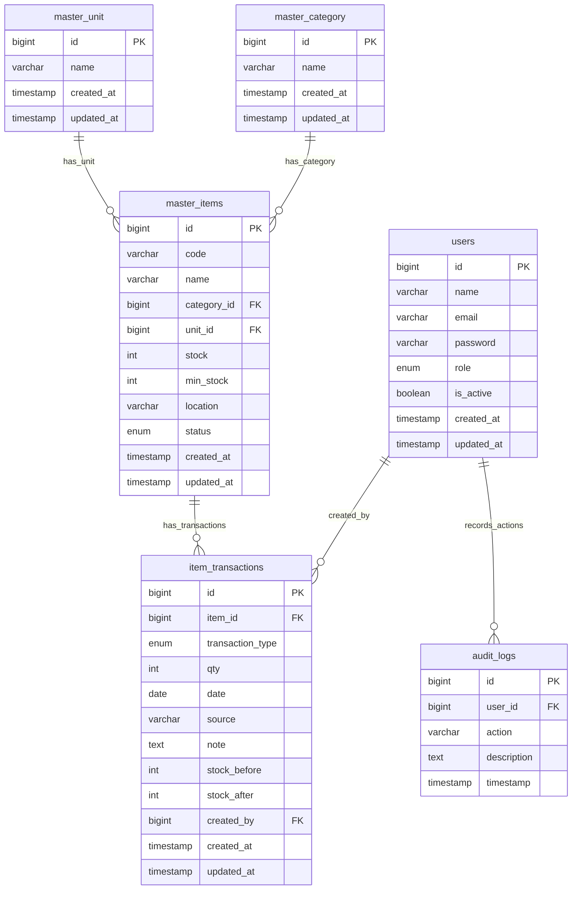

# BUKU PANDUAN PENGGUNA (USER MANUAL)
## SISTEM INVENTARIS BARANG BERBASIS WEB MENGGUNAKAN FRAMEWORK LARAVEL

---

### **COVER DOKUMEN**

**JUDUL SISTEM:**
Rancang Bangun Sistem Inventaris Barang Berbasis Web Menggunakan Framework Laravel pada Kantor Badan Akreditasi Nasional Pendidikan Anak Usia Dini, Pendidikan Dasar, dan Pendidikan Menengah Provinsi Papua Barat

**NAMA PENGEMBANG:**
[Nama Lengkap Pengembang / Pemohon HKI]

**PROGRAM STUDI:**
[Nama Program Studi / Jurusan]

**UNIVERSITAS:**
[Nama Universitas / Perguruan Tinggi]

**TAHUN:**
2026

---

## KATA PENGANTAR

Puji dan syukur kami panjatkan ke hadirat Tuhan Yang Maha Esa karena atas rahmat dan karunia-Nya, dokumen Buku Panduan Pengguna (*User Manual*) untuk aplikasi **Sistem Inventaris Barang Berbasis Web pada Kantor Badan Akreditasi Nasional Pendidikan Anak Usia Dini, Pendidikan Dasar, dan Pendidikan Menengah (BAN-PDM) Provinsi Papua Barat** ini dapat diselesaikan dengan baik.

Buku panduan ini disusun sebagai dokumen penunjang operasional sekaligus dokumen pendukung dalam rangka pengajuan Hak Kekayaan Intelektual (HKI) Program Komputer. Panduan ini bertujuan untuk memberikan penjelasan secara menyeluruh mengenai langkah-langkah instalasi, konfigurasi database, struktur penyimpanan data, hingga tata cara penggunaan aplikasi bagi semua tingkatan pengguna (Super Admin dan Operator).

Penerapan sistem inventaris ini diharapkan mampu meminimalisasi kesalahan pencatatan data logistik, mempercepat proses audit stok barang kantor, serta menyajikan laporan inventaris yang transparan dan akurat. Kami berharap panduan ini dapat mempermudah operasional sistem demi mendukung kelancaran administrasi kantor BAN-PDM Provinsi Papua Barat.

Papua Barat, Juni 2026

**Tim Pengembang**

---

## DAFTAR ISI

*   **KATA PENGANTAR**
*   **DAFTAR ISI**
*   **BAB 1 PENDAHULUAN**
    *   1.1 Latar Belakang Sistem
    *   1.2 Tujuan Buku Panduan
    *   1.3 Ruang Lingkup Sistem
*   **BAB 2 GAMBARAN UMUM SISTEM**
    *   2.1 Deskripsi Sistem
    *   2.2 Hak Akses Pengguna
    *   2.3 Arsitektur Sistem
*   **BAB 3 PANDUAN INSTALASI**
    *   3.1 Kebutuhan Sistem
    *   3.2 Instalasi Laravel
    *   3.3 Konfigurasi Database
    *   3.4 Menjalankan Sistem
*   **BAB 4 PANDUAN PENGGUNAAN SISTEM**
    *   4.1 Fitur Login
    *   4.2 Fitur Dashboard
    *   4.3 Fitur Kelola Akun
    *   4.4 Fitur Master Data (Kategori & Unit)
    *   4.5 Fitur Master Barang
    *   4.6 Fitur Input Transaksi (Barang Masuk/Keluar)
    *   4.7 Fitur Riwayat Transaksi
    *   4.8 Fitur Audit Log
    *   4.9 Fitur Laporan (Barang, Transaksi, & Stok)
    *   4.10 Fitur Profil Saya
*   **BAB 5 STRUKTUR DATABASE**
    *   5.1 Deskripsi Umum Database
    *   5.2 Kamus Data Struktur Tabel
*   **BAB 6 PENUTUP**
    *   6.1 Kesimpulan
    *   6.2 Saran Pengembangan
*   **LAMPIRAN**
    *   A. Use Case Diagram
    *   B. Entity Relationship Diagram (ERD)
    *   C. Panduan Pemasangan Screenshot Sistem

---

## BAB 1 PENDAHULUAN

### 1.1 Latar Belakang Sistem
Badan Akreditasi Nasional Pendidikan Anak Usia Dini, Pendidikan Dasar, dan Pendidikan Menengah (BAN-PDM) Provinsi Papua Barat merupakan lembaga yang bertanggung jawab dalam menjamin mutu pendidikan melalui kegiatan akreditasi institusi pendidikan. Dalam menjalankan operasional hariannya, kantor BAN-PDM Papua Barat membutuhkan berbagai macam sarana dan prasarana logistik, seperti Alat Tulis Kantor (ATK), perangkat elektronik, hingga kebutuhan kebersihan kantor. 

Selama ini, pengelolaan inventaris barang di kantor BAN-PDM Provinsi Papua Barat masih menggunakan sistem konvensional berupa pencatatan manual atau menggunakan aplikasi spreadsheet dasar (*Microsoft Excel*). Metode konvensional ini memiliki beberapa kelemahan utama, antara lain:
1.  **Kerentanan Selisih Data:** Risiko kesalahan manusia (*human error*) dalam mencatat barang masuk dan keluar sangat tinggi.
2.  **Audit Stok yang Lambat:** Tidak adanya kontrol real-time terhadap stok fisik barang membuat proses inventarisasi tahunan memakan waktu lama.
3.  **Keterbatasan Riwayat Aktivitas:** Sulitnya menelusuri penanggung jawab transaksi atau mendeteksi perubahan data barang secara historis.
4.  **Ketiadaan Peringatan Dini:** Sistem tidak memberikan notifikasi otomatis apabila stok barang penting berada di bawah batas minimum (*low stock*).

Untuk mengatasi kendala tersebut, dirancanglah **Sistem Inventaris Barang Berbasis Web Menggunakan Framework Laravel**. Aplikasi ini dirancang secara khusus untuk mendigitalisasi alur sirkulasi inventaris kantor secara real-time, meningkatkan transparansi data melalui catatan audit aktivitas (*audit log*), serta mempermudah pengambilan keputusan melalui laporan otomatis yang dapat diunduh kapan saja.

### 1.2 Tujuan Buku Panduan
Buku Panduan Pengguna (*User Manual*) ini disusun dengan tujuan sebagai berikut:
1.  Menyediakan acuan resmi mengenai tata cara instalasi, konfigurasi, dan implementasi sistem pada server lokal maupun production.
2.  Membantu pengguna sistem (Super Admin dan Operator) memahami fungsionalitas dan fitur-fitur yang ada di dalam aplikasi secara rinci.
3.  Meminimalisasi kendala teknis operasional dengan memberikan panduan pemecahan masalah dasar serta langkah penggunaan langkah-demi-langkah.
4.  Memenuhi syarat administrasi dokumen pendukung pengajuan Hak Kekayaan Intelektual (HKI) Program Komputer.

### 1.3 Ruang Lingkup Sistem
Sistem Inventaris Barang ini mencakup beberapa ruang lingkup fungsional sebagai berikut:
1.  **Autentikasi & Otorisasi:** Sistem login dengan enkripsi kata sandi yang membedakan peran (*role*) pengguna menjadi Super Admin dan Operator.
2.  **Manajemen Pengguna:** Pengelolaan status aktif pengguna (*toggle active*), pembuatan, pembaharuan data akun, serta penghapusan akun.
3.  **Manajemen Master Data:** Pengelompokan barang berdasarkan kategori dan unit kemasan.
4.  **Manajemen Master Barang:** Pencatatan kode barang otomatis berdasarkan inisial kategori, lokasi penyimpanan fisik, batas stok minimum, serta deteksi otomatis status stok rendah.
5.  **Pencatatan Transaksi:** Pencatatan sirkulasi barang masuk (dari pengadaan/supplier) dan barang keluar (kepada penerima/departemen) dalam satu antarmuka terpadu.
6.  **Audit Log:** Pencatatan otomatis setiap aksi penting yang dilakukan oleh pengguna untuk keperluan keamanan data.
7.  **Pelaporan Inventaris:** Pembuatan laporan periodik berbasis tabel dinamis yang dapat diekspor secara instan ke format PDF dan Excel.

---

## BAB 2 GAMBARAN UMUM SISTEM

### 2.1 Deskripsi Sistem
Sistem Inventaris Barang Berbasis Web ini dibangun dengan menggunakan arsitektur MVC (*Model-View-Controller*) dari framework PHP Laravel. Sistem ini memusatkan seluruh pencatatan inventaris kantor BAN-PDM Provinsi Papua Barat ke dalam satu pangkalan data (*database* MySQL). Penggunaan sistem berbasis web ini memungkinkan akses yang responsif melalui berbagai perangkat (komputer desktop, laptop, maupun tablet) melalui jaringan intranet kantor atau internet.

### 2.2 Hak Akses Pengguna
Aplikasi ini memiliki 2 (dua) tingkat hak akses pengguna yang diatur melalui autentikasi sistem. Berikut adalah tabel penjelasan fungsi hak akses:

| Peran (Role) | Hak Akses Fitur Utama | Keterangan Fungsional |
| :--- | :--- | :--- |
| **Super Admin** | Semua Fitur (Dashboard, Master Barang, Input Transaksi, Laporan, Riwayat Transaksi, Kelola Akun, Kategori & Unit, Audit Log) | Peran tingkat tertinggi dengan hak akses penuh ke seluruh sistem. Berwenang untuk mendaftarkan akun baru, menonaktifkan/menghapus akun pengguna lain, mengelola klasifikasi kategori & unit, serta memantau log aktivitas sistem. |
| **Operator** | Fitur Terbatas (Dashboard, Master Barang, Input Transaksi, Laporan, Riwayat Transaksi, dan Edit Profil Sendiri) | Peran operasional harian. Berwenang untuk menambah data barang, mencatat barang masuk/keluar, dan mengunduh laporan. Operator **tidak diizinkan** mengakses halaman Kategori & Unit, tidak dapat melihat halaman Audit Log, serta hanya bisa mengubah data profilnya sendiri di halaman Kelola Akun. |

### 2.3 Arsitektur Sistem
Sistem ini dirancang menggunakan fondasi teknologi modern berikut:
1.  **Framework Laravel (PHP):** Digunakan sebagai mesin utama sisi belakang (*backend*) karena memiliki sistem keamanan bawaan terhadap serangan SQL Injection, Cross-Site Request Forgery (CSRF), serta Cross-Site Scripting (XSS).
2.  **MySQL Database:** Digunakan sebagai basis data relasional untuk menyimpan data pengguna, kategori, unit, barang, transaksi, dan log audit dengan integritas referensial yang aman (*Foreign Keys*).
3.  **Tailwind CSS & JavaScript:** Digunakan pada sisi antarmuka depan (*frontend*) untuk mewujudkan tampilan yang bersih, responsif, dan estetik dengan palet warna resmi BAN-PDM (Navy, Gold, dan Forest Green).

---

## BAB 3 PANDUAN INSTALASI

### 3.1 Kebutuhan Sistem
Untuk menjalankan aplikasi secara optimal, komputer atau server harus memenuhi spesifikasi minimum berikut:

#### A. Kebutuhan Perangkat Keras (Hardware)
*   **Processor:** Intel Core i3 / AMD Ryzen 3 (atau setara/lebih tinggi).
*   **RAM:** Minimal 4 GB (Disarankan 8 GB).
*   **Penyimpanan:** Minimal 10 GB ruang kosong pada Hard Drive / SSD.

#### B. Kebutuhan Perangkat Lunak (Software)
*   **Sistem Operasi:** Windows 10/11, macOS, atau Linux Ubuntu.
*   **Web Server Environment:** Laragon (Sangat direkomendasikan) atau XAMPP.
*   **PHP Engine:** Versi 8.2 atau lebih tinggi (harus mengaktifkan ekstensi PDO, OpenSSL, Mbstring, XML, Ctype, dan BCMath).
*   **Database Server:** MySQL versi 5.7 atau MariaDB versi 10.4 ke atas.
*   **Package Manager:** Composer (untuk dependensi PHP) dan Node.js (dengan npm, untuk aset bundler Vite).
*   **Web Browser:** Google Chrome, Microsoft Edge, atau Mozilla Firefox versi terbaru.

### 3.2 Instalasi Laravel
Berikut adalah langkah-langkah memasang aplikasi pada server lokal (contoh menggunakan lingkungan **Laragon** di sistem operasi Windows):
1.  Salin folder source code aplikasi `inventaris-app` ke direktori web server root Anda (contoh: `C:\laragon\www\inventaris-app`).
2.  Buka terminal/command prompt dan masuk ke direktori aplikasi tersebut:
    ```bash
    cd C:\laragon\www\inventaris-app
    ```
3.  Jalankan perintah berikut untuk memasang seluruh dependensi PHP (laravel framework dan pustaka pendukung seperti DomPDF, Laravel Excel) yang tercantum di file `composer.json`:
    ```bash
    composer install
    ```
4.  Jalankan perintah berikut untuk memasang dependensi Javascript dan CSS:
    ```bash
    npm install
    ```

### 3.3 Konfigurasi Database
1.  Salin berkas konfigurasi lingkungan `.env.example` menjadi berkas baru bernama `.env`:
    ```bash
    copy .env.example .env
    ```
2.  Buka berkas `.env` menggunakan teks editor (seperti VS Code atau Notepad), kemudian sesuaikan baris konfigurasi database berikut dengan server Anda:
    ```ini
    DB_CONNECTION=mysql
    DB_HOST=127.0.0.1
    DB_PORT=3306
    DB_DATABASE=inventaris_db
    DB_USERNAME=root
    DB_PASSWORD=
    ```
3.  Aktifkan aplikasi DBMS MySQL Anda (misalnya melalui panel kontrol Laragon/XAMPP).
4.  Buka alat bantu manajemen database seperti phpMyAdmin atau HeidiSQL, lalu buat sebuah database baru dengan nama `inventaris_db`.
5.  Kembali ke terminal, jalankan perintah pembuatan kunci enkripsi aplikasi:
    ```bash
    php artisan key:generate
    ```
6.  Jalankan perintah migrasi tabel beserta pengisian data awal (*seeder*) ke dalam database:
    ```bash
    php artisan migrate --seed
    ```
    *Catatan: Langkah ini akan membuat semua struktur tabel relasional dan membuat akun pengguna awal untuk login.*

### 3.4 Menjalankan Sistem
1.  Lakukan kompilasi aset frontend (Tailwind CSS dan Javascript) dengan perintah berikut:
    ```bash
    npm run build
    ```
2.  Jalankan server lokal internal Laravel dengan mengetikkan perintah berikut pada terminal:
    ```bash
    php artisan serve
    ```
3.  Terminal akan menampilkan informasi alamat server lokal, biasanya:
    ```
    INFO  Server running on [http://127.0.0.1:8000].
    ```
4.  Buka web browser Anda, ketikkan alamat `http://127.0.0.1:8000` di bilah alamat, lalu tekan Enter. Anda akan diarahkan ke halaman login utama aplikasi.

---

## BAB 4 PANDUAN PENGGUNAAN SISTEM

### 4.1 Fitur Login
*   **Deskripsi Fitur:** Memvalidasi akun pengguna sebelum diizinkan masuk ke dalam sistem inventaris. Fitur ini membatasi akses ilegal dari pengguna yang tidak terdaftar.
*   **Langkah Penggunaan:**
    1.  Buka alamat aplikasi di browser (`http://127.0.0.1:8000`).
    2.  Ketikkan **Email** pengguna (Contoh akun awal: `superadmin@kantor.com` untuk Super Admin, atau `operator@kantor.com` untuk Operator).
    3.  Ketikkan **Password** (Contoh password awal: `admin12345` atau `operator123`).
    4.  Klik tombol **"Log in"**.
*   **Hasil yang Diharapkan:** Pengguna berhasil masuk dan sistem secara otomatis mengarahkan ke halaman Dashboard sesuai peran masing-masing, serta mencatat aktivitas login tersebut ke halaman Audit Log.
*   **Screenshot Tampilan:**
    `[Tempel Gambar 4.1: Antarmuka Halaman Login di Sini]`
    *Keterangan Gambar 4.1: Form Login sistem.*

### 4.2 Fitur Dashboard
*   **Deskripsi Fitur:** Menyajikan ringkasan statistik inventaris terkini secara visual. Fitur ini mencakup kartu indikator kuantitatif, bagan perbandingan stok per kategori barang, tabel barang dengan stok kritis (rendah), serta daftar 10 transaksi sirkulasi terbaru.
*   **Langkah Penggunaan:**
    1.  Setelah berhasil login, pengguna secara otomatis berada di halaman Dashboard.
    2.  Pengguna dapat memantau 4 kartu indikator utama: **Total Barang**, **Total Masuk** (akumulasi kuantitas barang masuk), **Total Keluar** (akumulasi kuantitas barang keluar), dan **Stok Rendah** (jumlah item yang stoknya kritis).
    3.  Periksa bagan visual **Stok Per Kategori** di sisi kiri tengah untuk melihat penyebaran stok.
    4.  Periksa tabel **Barang Stok Rendah** di sisi kanan tengah untuk mendeteksi barang yang perlu segera dipesan ulang (*restok*).
*   **Hasil yang Diharapkan:** Memperoleh informasi cepat mengenai status kesehatan inventaris kantor tanpa harus membuka laporan terpisah.
*   **Screenshot Tampilan:**
    `[Tempel Gambar 4.2: Tampilan Dashboard Utama di Sini]`
    *Keterangan Gambar 4.2: Tampilan Dashboard dengan grafik data stok dan transaksi terbaru.*

### 4.3 Fitur Kelola Akun
*   **Deskripsi Fitur:** Halaman pengelolaan data pengguna sistem (`/users`). Fitur ini bertindak secara dinamis berdasarkan peran pengguna:
    *   **Super Admin:** Dapat melihat daftar semua user, membuat akun baru, mengedit akun siapa saja, menonaktifkan/mengaktifkan akun (*toggle active status*), dan menghapus akun.
    *   **Operator:** Hanya dapat melihat daftar nama user lain dan memiliki tombol khusus **"Edit Profil"** pada baris namanya sendiri untuk mengubah profilnya.
*   **Langkah Penggunaan (Membuat Akun Baru - Khusus Super Admin):**
    1.  Klik menu **Kelola Akun** di sidebar.
    2.  Pada panel kanan **"Buat Akun Baru"**, isi Nama Lengkap, Email Kantor, Kata Sandi, tentukan Role (Operator/Super Admin), dan pilih Status Akun (Aktif/Nonaktif).
    3.  Klik tombol **"Buat Akun"**.
*   **Langkah Penggunaan (Mengaktifkan/Menonaktifkan Akun - Khusus Super Admin):**
    1.  Di tabel akun, cari baris nama pengguna yang ingin diubah statusnya.
    2.  Klik tombol **"Nonaktifkan"** atau **"Aktifkan"**.
    3.  Sistem akan mengubah opasitas baris data menjadi pudar jika dinonaktifkan, dan pengguna tersebut tidak akan bisa login ke sistem lagi.
*   **Hasil yang Diharapkan:** Data pengguna terkelola dengan aman, dan perubahan status pengguna langsung memengaruhi izin login mereka saat itu juga.
*   **Screenshot Tampilan:**
    `[Tempel Gambar 4.3: Halaman Kelola Akun di Sini]`
    *Keterangan Gambar 4.3: Daftar akun pengguna dan form pembuatan akun baru.*

### 4.4 Fitur Master Data (Kategori & Unit)
*   **Deskripsi Fitur:** Halaman terpadu (`/master-data`) untuk mengelola klasifikasi barang (Kategori dan Satuan Unit). Fitur ini **hanya dapat diakses oleh Super Admin**. Kategori berfungsi sebagai pengelompokan jenis barang dan dasar pembuatan awalan kode otomatis (misal: kategori Elektronik menghasilkan awalan kode ELK). Unit mendefinisikan satuan barang (misal: Pcs, Buah, Rim).
*   **Langkah Penggunaan (Menambah Kategori):**
    1.  Klik menu **Kategori & Unit** pada grup menu Master Data di sidebar.
    2.  Di panel kiri **"Tambah Kategori"**, ketikkan nama kategori baru (contoh: "Alat Tulis Kantor").
    3.  Klik tombol **"Tambah"**.
*   **Langkah Penggunaan (Menambah Unit Satuan):**
    1.  Di panel kanan **"Tambah Unit"**, ketikkan nama unit satuan baru (contoh: "Rim").
    2.  Klik tombol **"Tambah"**.
*   **Langkah Penggunaan (Menghapus Kategori atau Unit):**
    1.  Di tabel daftar Kategori atau Unit, klik tombol **"Hapus"** pada item yang diinginkan.
    2.  *Catatan: Tombol hapus akan dinonaktifkan (berwarna abu-abu) secara otomatis jika kategori/unit tersebut sedang digunakan oleh data barang di gudang untuk menjaga integritas database.*
*   **Hasil yang Diharapkan:** Kategori dan unit berhasil ditambahkan ke database dan langsung siap digunakan sebagai pilihan saat mendaftarkan barang baru.
*   **Screenshot Tampilan:**
    `[Tempel Gambar 4.4: Halaman Kategori & Unit di Sini]`
    *Keterangan Gambar 4.4: Halaman manajemen Kategori Barang dan Satuan Unit.*

### 4.5 Fitur Master Barang
*   **Deskripsi Fitur:** Halaman pengelolaan katalog inventaris (`/barang`). Di sini, pengguna (Super Admin & Operator) dapat mencari barang berdasarkan nama/kode, menyaring barang berdasarkan kategori, meregistrasikan barang baru dengan pembuatan kode otomatis berdasarkan kategori, serta mengubah lokasi barang atau batas stok minimum.
*   **Langkah Penggunaan (Menambah Barang Baru):**
    1.  Klik menu **Master Barang** di sidebar, lalu klik tombol **"Tambah Barang"** di pojok kanan atas.
    2.  Ketikkan nama barang (misal: "Kertas A4 80gsm").
    3.  Pilih **Kategori** (sistem akan langsung memicu kode barang otomatis, misal: `ATK-001`).
    4.  Pilih **Satuan Unit** (misal: "Rim").
    5.  Ketikkan **Stok Awal** dan **Batas Stok Minimum** (misal: jika batas diisi 10, maka sistem akan memberi tanda bahaya stok rendah jika stok tersisa <= 10).
    6.  Ketikkan lokasi penyimpanan (misal: "Gudang Utama"). Klik **"Tambah Barang"**.
*   **Hasil yang Diharapkan:** Barang terdaftar di katalog dengan kode unik yang terbuat otomatis, dan status stok terpantau secara berkala.
*   **Screenshot Tampilan:**
    `[Tempel Gambar 4.5: Daftar Master Barang di Sini]`
    *Keterangan Gambar 4.5: Tabel katalog Master Barang dengan filter pencarian.*

### 4.6 Fitur Input Transaksi (Barang Masuk/Keluar)
*   **Deskripsi Fitur:** Form dinamis terintegrasi (`/transaksi/create`) untuk mencatat sirkulasi keluar masuk barang fisik. Form ini menggunakan Javascript untuk beralih tipe secara cepat tanpa muat ulang halaman:
    *   **Barang Masuk (Warna Hijau):** Untuk mencatat penambahan stok dari pengadaan/supplier.
    *   **Barang Keluar (Warna Merah):** Untuk mencatat pengurangan stok karena penggunaan internal kantor.
*   **Langkah Penggunaan:**
    1.  Klik menu **Input Transaksi** di sidebar, lalu klik tombol **"Input Transaksi"**.
    2.  Pilih tipe transaksi di bagian atas form: **Barang Masuk** (Tab Hijau) atau **Barang Keluar** (Tab Merah).
    3.  Pilih nama barang dari kotak drop-down. Sistem akan menampilkan kotak info kecil yang berisi data real-time: Kategori barang, Satuan unit, dan Jumlah stok yang ada saat ini di gudang.
    4.  Ketikkan **Jumlah (Qty)** transaksi. 
        *Catatan penting: Untuk transaksi Barang Keluar, apabila jumlah qty yang diinput melebihi stok saat ini, sistem akan menolak transaksi dan menampilkan pesan eror "Stok tidak cukup!".*
    5.  Pilih tanggal transaksi dan ketikkan keterangan pada kolom Sumber/Penerima (misal: "Pengadaan CV Jaya" untuk barang masuk, atau "Diserahkan ke Bagian Kepegawaian" untuk barang keluar).
    6.  Ketikkan catatan opsional pada kolom Catatan, lalu klik tombol simpan di bagian bawah.
*   **Hasil yang Diharapkan:** Transaksi tersimpan, kuantitas stok barang pada Master Barang otomatis bertambah (untuk barang masuk) atau berkurang (untuk barang keluar), dan riwayat tercatat di database.
*   **Screenshot Tampilan:**
    `[Tempel Gambar 4.6: Form Input Transaksi di Sini]`
    *Keterangan Gambar 4.6: Form pengisian data transaksi keluar/masuk barang dengan indikator info stok dinamis.*

### 4.7 Fitur Riwayat Transaksi
*   **Deskripsi Fitur:** Halaman pencatatan riwayat sirkulasi barang secara komprehensif (`/riwayat`). Halaman ini dirancang untuk pencarian berkas transaksi masa lalu dengan filter pencarian nama barang, tipe transaksi, dan rentang tanggal transaksi.
*   **Langkah Penggunaan:**
    1.  Klik menu **Riwayat Transaksi** di sidebar.
    2.  Ketikkan nama/kode barang pada kolom pencarian, pilih tipe transaksi (Masuk/Keluar), atau tentukan rentang tanggal awal (*Dari*) dan tanggal akhir (*Sampai*).
    3.  Klik tombol **"Search"**.
*   **Hasil yang Diharapkan:** Sistem menampilkan baris transaksi yang sesuai dengan kriteria penyaringan, lengkap dengan info kuantitas stok sebelum (*stock before*) dan setelah (*stock after*) transaksi tersebut terjadi.
*   **Screenshot Tampilan:**
    `[Tempel Gambar 4.7: Tampilan Halaman Riwayat Transaksi di Sini]`
    *Keterangan Gambar 4.7: Tabel riwayat transaksi dengan fungsionalitas filter data.*

### 4.8 Fitur Audit Log
*   **Deskripsi Fitur:** Halaman log sistem (`/auditlog`) yang **hanya bisa diakses oleh peran Super Admin**. Fitur ini melacak dan merekam setiap aksi perubahan data penting di aplikasi (Login, Logout, penambahan/penghapusan user, barang, transaksi, kategori, dan unit), lengkap dengan nama operator, waktu kejadian, dan detail deskripsi perubahan.
*   **Langkah Penggunaan:**
    1.  Login menggunakan akun Super Admin.
    2.  Klik menu **Audit Log** di sidebar bawah.
    3.  Tinjau tabel aktivitas terurut dari yang paling terbaru. Kolom aksi memiliki badge warna khusus untuk mempermudah identifikasi (contoh: Merah untuk aksi `DELETE_USER` / `DELETE_ITEM`, Hijau untuk `ADD_ITEM`, Ungu untuk `TRANSACTION`).
*   **Hasil yang Diharapkan:** Memperoleh bukti audit digital yang valid guna meningkatkan aspek akuntabilitas dan keamanan operasional aplikasi.
*   **Screenshot Tampilan:**
    `[Tempel Gambar 4.8: Halaman Audit Log di Sini]`
    *Keterangan Gambar 4.8: Tabel catatan aktivitas audit log pengguna sistem.*

### 4.9 Fitur Laporan (Barang, Transaksi, & Stok)
*   **Deskripsi Fitur:** Halaman pengolahan laporan terpadu (`/laporan`) yang menyajikan tiga tab laporan interaktif. Masing-masing laporan dapat diekspor secara instan ke format **PDF (Cetak PDF)**, format **Excel (Export Excel)**, maupun dicetak langsung secara fisik menggunakan printer kertas melalui fitur **Print Halaman**.
    1.  **Laporan Barang:** Berisi daftar inventaris aktif kantor, kode, kategori, unit, lokasi, dan status keaktifan.
    2.  **Laporan Transaksi:** Berisi laporan sirkulasi barang masuk dan keluar dengan penyaringan tipe transaksi serta rentang periode tanggal tertentu.
    3.  **Laporan Stok:** Berisi laporan mutasi atau perputaran stok barang, menghitung total kuantitas barang masuk, total kuantitas barang keluar, serta memberikan status otomatis apakah stok dalam kategori "Aman" atau "Perlu Restok".
*   **Langkah Penggunaan:**
    1.  Klik menu **Laporan** di sidebar.
    2.  Klik salah satu tab di bagian atas: **Laporan Barang**, **Laporan Transaksi**, atau **Laporan Stok**.
    3.  Untuk mengunduh dokumen, klik tombol berwarna merah **"Cetak PDF"** (mengunduh berkas `.pdf`), klik tombol hijau **"Export Excel"** (mengunduh berkas `.xlsx`), atau klik tombol navy **"Print Halaman"** (membuka dialog print browser bawaan).
*   **Hasil yang Diharapkan:** Menghasilkan dokumen laporan profesional dalam hitungan detik yang siap diserahkan kepada pimpinan kantor BAN-PDM Papua Barat.
*   **Screenshot Tampilan:**
    `[Tempel Gambar 4.9: Halaman Laporan Terintegrasi di Sini]`
    *Keterangan Gambar 4.9: Halaman ekspor laporan inventaris barang.*

### 4.10 Fitur Profil Saya
*   **Deskripsi Fitur:** Halaman profil (`/profile`) yang menyajikan informasi akun pengguna yang sedang login saat ini (Nama Lengkap, Email, Peran/Role, dan Status Keaktifan). Halaman ini bersifat read-only untuk mempermudah pengguna memverifikasi informasi identitas mereka dengan cepat.
*   **Langkah Penggunaan:**
    1.  Arahkan kursor ke bagian bawah sidebar sebelah kiri.
    2.  Klik pada Nama Pengguna atau lingkaran inisial nama Anda.
    3.  Aplikasi akan mengarahkan ke halaman profil pribadi yang menampilkan kartu identitas user.
*   **Hasil yang Diharapkan:** Pengguna dapat memastikan bahwa mereka telah login dengan kredensial dan tingkat otoritas role yang benar.
*   **Screenshot Tampilan:**
    `[Tempel Gambar 4.10: Halaman Detail Profil di Sini]`
    *Keterangan Gambar 4.10: Halaman informasi ringkasan profil pribadi.*

---

## BAB 5 STRUKTUR DATABASE

### 5.1 Deskripsi Umum Database
Aplikasi Sistem Inventaris Barang ini menggunakan MySQL sebagai sistem manajemen basis data (*DBMS*). Struktur database dirancang menggunakan relasi yang ketat (*Strict Foreign Keys*) untuk menjaga konsistensi data. Apabila terdapat data master (kategori/unit/barang) yang memiliki transaksi aktif terkait, database secara otomatis menolak penghapusan (*onDelete('restrict')*) untuk mencegah kerusakan riwayat laporan keuangan/transaksi inventaris kantor.

### 5.2 Kamus Data Struktur Tabel

Berikut adalah tabel kamus data lengkap dari seluruh tabel database yang digunakan oleh sistem:

#### 1. Tabel: `users`
Tabel ini digunakan untuk menyimpan data otentikasi kredensial pengguna dan penentuan peran (role).
*   **Primary Key:** `id`

| Nama Kolom | Tipe Data | Nullable | Default | Keterangan / Fungsi |
| :--- | :--- | :---: | :--- | :--- |
| `id` | bigint unsigned | No | Auto Increment | ID unik pengenal pengguna. |
| `name` | varchar(255) | No | - | Nama lengkap pengguna sistem. |
| `email` | varchar(255) | No | - | Alamat email unik untuk login. |
| `email_verified_at` | timestamp | Yes | NULL | Tanggal verifikasi email (jika ada). |
| `password` | varchar(255) | No | - | Kata sandi pengguna yang dienkripsi (Hash BCRYPT). |
| `role` | enum('superadmin', 'operator') | No | 'operator' | Hak akses tingkat otorisasi sistem. |
| `is_active` | boolean | No | 1 (true) | Status keaktifan akun (1 = aktif, 0 = nonaktif). |
| `remember_token` | varchar(100) | Yes | NULL | Token keamanan sesi login. |
| `created_at` | timestamp | Yes | NULL | Tanggal akun pertama kali dibuat. |
| `updated_at` | timestamp | Yes | NULL | Tanggal akun terakhir kali diubah. |

#### 2. Tabel: `master_category`
Tabel ini menyimpan kategori atau kelompok jenis barang inventaris.
*   **Primary Key:** `id`

| Nama Kolom | Tipe Data | Nullable | Default | Keterangan / Fungsi |
| :--- | :--- | :---: | :--- | :--- |
| `id` | bigint unsigned | No | Auto Increment | ID unik pengenal kategori. |
| `name` | varchar(100) | No | - | Nama kategori barang (Unik). |
| `created_at` | timestamp | Yes | NULL | Tanggal pembuatan data kategori. |
| `updated_at` | timestamp | Yes | NULL | Tanggal perubahan data kategori. |

#### 3. Tabel: `master_unit`
Tabel ini menyimpan jenis satuan/unit ukuran kemasan barang inventaris.
*   **Primary Key:** `id`

| Nama Kolom | Tipe Data | Nullable | Default | Keterangan / Fungsi |
| :--- | :--- | :---: | :--- | :--- |
| `id` | bigint unsigned | No | Auto Increment | ID unik pengenal unit satuan. |
| `name` | varchar(50) | No | - | Nama unit satuan barang (Unik). |
| `created_at` | timestamp | Yes | NULL | Tanggal pembuatan data unit. |
| `updated_at` | timestamp | Yes | NULL | Tanggal perubahan data unit. |

#### 4. Tabel: `master_items`
Tabel utama katalog barang inventaris yang terhubung dengan kategori dan unit satuan.
*   **Primary Key:** `id`
*   **Foreign Key:** `category_id` (ke `master_category.id`), `unit_id` (ke `master_unit.id`)
*   **Indexes:** `name` (index), `category_id` (index) untuk mempercepat proses pencarian data.

| Nama Kolom | Tipe Data | Nullable | Default | Keterangan / Fungsi |
| :--- | :--- | :---: | :--- | :--- |
| `id` | bigint unsigned | No | Auto Increment | ID unik pengenal barang. |
| `code` | varchar(50) | No | - | Kode unik barang yang dibuat otomatis (Unik). |
| `name` | varchar(100) | No | - | Nama barang inventaris. |
| `category_id` | bigint unsigned | No | - | Relasi ke tabel kategori barang. |
| `unit_id` | bigint unsigned | No | - | Relasi ke tabel unit satuan barang. |
| `stock` | int | No | 0 | Jumlah kuantitas stok saat ini di gudang. |
| `min_stock` | int | No | - | Jumlah batas stok minimum sebelum dinyatakan kritis. |
| `location` | varchar(100) | Yes | NULL | Keterangan lokasi penyimpanan fisik barang. |
| `status` | enum('active', 'inactive') | No | 'active' | Status aktif/nonaktifnya barang tersebut di gudang. |
| `created_at` | timestamp | Yes | NULL | Tanggal barang didaftarkan ke sistem. |
| `updated_at` | timestamp | Yes | NULL | Tanggal data barang terakhir diperbarui. |

#### 5. Tabel: `item_transactions`
Tabel pencatatan setiap transaksi barang masuk dan barang keluar.
*   **Primary Key:** `id`
*   **Foreign Key:** `item_id` (ke `master_items.id`), `created_by` (ke `users.id`)
*   **Indexes:** `date` (index), `transaction_type` (index) untuk mempermudah filter laporan secara cepat.

| Nama Kolom | Tipe Data | Nullable | Default | Keterangan / Fungsi |
| :--- | :--- | :---: | :--- | :--- |
| `id` | bigint unsigned | No | Auto Increment | ID unik berkas transaksi. |
| `item_id` | bigint unsigned | No | - | Relasi ke tabel barang yang ditransaksikan. |
| `transaction_type` | enum('in', 'out') | No | - | Tipe transaksi (in = barang masuk, out = barang keluar). |
| `qty` | int | No | - | Kuantitas jumlah barang yang ditransaksikan. |
| `date` | date | No | - | Tanggal terjadinya transaksi fisik barang. |
| `source` | varchar(100) | Yes | NULL | Keterangan asal/tujuan (Supplier/Penerima barang). |
| `note` | text | Yes | NULL | Catatan tambahan transaksi. |
| `stock_before` | int | No | 0 | Posisi stok barang sebelum transaksi ini dicatat. |
| `stock_after` | int | No | 0 | Posisi stok barang setelah transaksi ini dicatat. |
| `created_by` | bigint unsigned | Yes | NULL | Relasi ke ID user yang mencatat transaksi. |
| `created_at` | timestamp | Yes | NULL | Tanggal transaksi disimpan ke sistem. |
| `updated_at` | timestamp | Yes | NULL | Tanggal data transaksi diperbarui. |

#### 6. Tabel: `audit_logs`
Tabel perekaman audit jejak aktivitas penting seluruh pengguna.
*   **Primary Key:** `id`
*   **Foreign Key:** `user_id` (ke `users.id`)

| Nama Kolom | Tipe Data | Nullable | Default | Keterangan / Fungsi |
| :--- | :--- | :---: | :--- | :--- |
| `id` | bigint unsigned | No | Auto Increment | ID unik entri log audit. |
| `user_id` | bigint unsigned | Yes | NULL | Relasi ke ID user yang melakukan aktivitas. |
| `action` | varchar(100) | No | - | Nama jenis aktivitas (contoh: LOGIN, ADD_ITEM). |
| `description` | text | Yes | NULL | Uraian detail keterangan aktivitas dan data. |
| `timestamp` | timestamp | No | CURRENT_TIMESTAMP | Waktu pencatatan log aktivitas secara sistem. |

---

## BAB 6 PENUTUP

### 6.1 Kesimpulan
Rancang Bangun Sistem Inventaris Barang Berbasis Web pada Kantor Badan Akreditasi Nasional Pendidikan Anak Usia Dini, Pendidikan Dasar, dan Pendidikan Menengah (BAN-PDM) Provinsi Papua Barat ini telah berhasil diimplementasikan menggunakan Laravel. Sistem ini berhasil mendigitalisasi alur pencatatan inventaris kantor secara efisien. 

Melalui fitur-fitur seperti pembuatan kode otomatis, deteksi stok rendah, pembatasan hak akses yang jelas, pelaporan digital yang lengkap, serta pengamanan audit aktivitas (*audit log*), sistem ini dapat meminimalkan selisih barang fisik dengan catatan sistem serta mempermudah manajemen logistik kantor. Oleh karena itu, sistem ini sangat layak diajukan dan dilindungi sebagai ciptaan di bawah naungan Hak Kekayaan Intelektual (HKI) kategori Program Komputer.

### 6.2 Saran Pengembangan
Demi peningkatan kinerja sistem di masa mendatang, disarankan beberapa pengembangan sebagai berikut:
1.  **Integrasi Scan Barcode/QR Code:** Menambahkan modul pembacaan kode QR melalui kamera ponsel atau barcode scanner eksternal untuk mempercepat registrasi barang dan penginputan kuantitas barang keluar/masuk.
2.  **Sistem Notifikasi Email/WhatsApp:** Menghubungkan sistem dengan API notifikasi email atau WhatsApp Gateway guna mengirim pesan peringatan secara otomatis kepada Super Admin/Kepala Kantor ketika stok barang kritis atau mendekati kosong.
3.  **Modul Depresiasi Aset:** Menambahkan perhitungan nilai penyusutan aset kantor secara otomatis berdasarkan masa manfaat barang elektronik atau furnitur kantor (menggunakan metode garis lurus/saldo menurun).

---

## LAMPIRAN

### A. Use Case Diagram
Berikut adalah pemodelan Use Case Diagram sistem inventaris barang dalam representasi Mermaid Syntax. Diagram ini menggambarkan hubungan interaksi antara aktor (Super Admin & Operator) dengan fungsi-fungsi utama di dalam sistem.

```mermaid
flowchart TD
    subgraph Aktor
        Admin["Super Admin (Aktor)"]
        Op["Operator (Aktor)"]
    end

    subgraph Halaman["Sistem Inventaris Barang BAN-PDM Papua Barat"]
        UC_Login(["Melakukan Login"])
        UC_Dashboard(["Memantau Statistik (Dashboard)"])
        UC_Barang(["Mengelola Master Barang"])
        UC_InputTrans(["Menginput Transaksi Barang"])
        UC_Riwayat(["Melihat Riwayat Transaksi"])
        UC_Laporan(["Mengunduh & Mencetak Laporan"])
        UC_EditSelf(["Mengubah Profil Sendiri"])
        
        UC_MasterData(["Mengelola Kategori & Unit"])
        UC_Users(["Mengelola Pengguna (Kelola Akun)"])
        UC_Audit(["Memantau Log Aktivitas (Audit Log)"])
    end

    Admin --- UC_Login
    Admin --- UC_Dashboard
    Admin --- UC_Barang
    Admin --- UC_InputTrans
    Admin --- UC_Riwayat
    Admin --- UC_Laporan
    Admin --- UC_EditSelf
    Admin --- UC_MasterData
    Admin --- UC_Users
    Admin --- UC_Audit

    Op --- UC_Login
    Op --- UC_Dashboard
    Op --- UC_Barang
    Op --- UC_InputTrans
    Op --- UC_Riwayat
    Op --- UC_Laporan
    Op --- UC_EditSelf
```



### B. Entity Relationship Diagram (ERD)
ERD berikut menyajikan relasi antar entitas basis data (*database*) yang digunakan dalam sistem inventaris, lengkap dengan kunci utama (*Primary Keys*), kunci tamu (*Foreign Keys*), serta tipe kardinalitas relasi datanya.



### C. Panduan Pemasangan Screenshot Sistem
Untuk mempermudah pemindahan dokumen Markdown ini ke Microsoft Word dalam rangka pengajuan HKI, harap ikuti petunjuk berikut:
1.  **Menyalin Isi Panduan:** Blok seluruh konten dari dokumen panduan ini, klik kanan pilih **Copy**, kemudian buka berkas dokumen kosong di **Microsoft Word** dan **Paste**.
2.  **Mengisi Gambar Screenshot:** Jalankan aplikasi inventaris di server lokal Anda (`php artisan serve`). Masuk ke masing-masing halaman sesuai judul fitur pada Bab 4. Tekan tombol `Windows + Shift + S` (atau aplikasi *Snipping Tool*) untuk menangkap layar halaman aplikasi. Hapus tulisan penanda `[Tempel Gambar 4.x: ...]` di Microsoft Word, lalu tekan `Ctrl + V` untuk menempelkan gambar tangkapan layar tersebut.
3.  **Mengubah Diagram Mermaid menjadi Gambar:**
    *   Salin kode diagram Mermaid dari Lampiran A dan B.
    *   Buka situs web [Mermaid Live Editor](https://mermaid.live).
    *   Tempelkan kode di area input sisi kiri.
    *   Ekspor diagram tersebut dalam format file PNG atau SVG berkualitas tinggi melalui menu ekspor di sisi kanan bawah.
    *   Masukkan gambar diagram tersebut ke bagian Lampiran A dan Lampiran B di dalam dokumen Microsoft Word Anda.
4.  **Format Akhir Dokumen:** Gunakan jenis huruf (*font*) formal seperti **Times New Roman** ukuran 12 pt dengan spasi 1.5, serta berikan nomor halaman di bagian pojok kanan bawah agar dokumen memenuhi kelayakan pengajuan HKI resmi.
